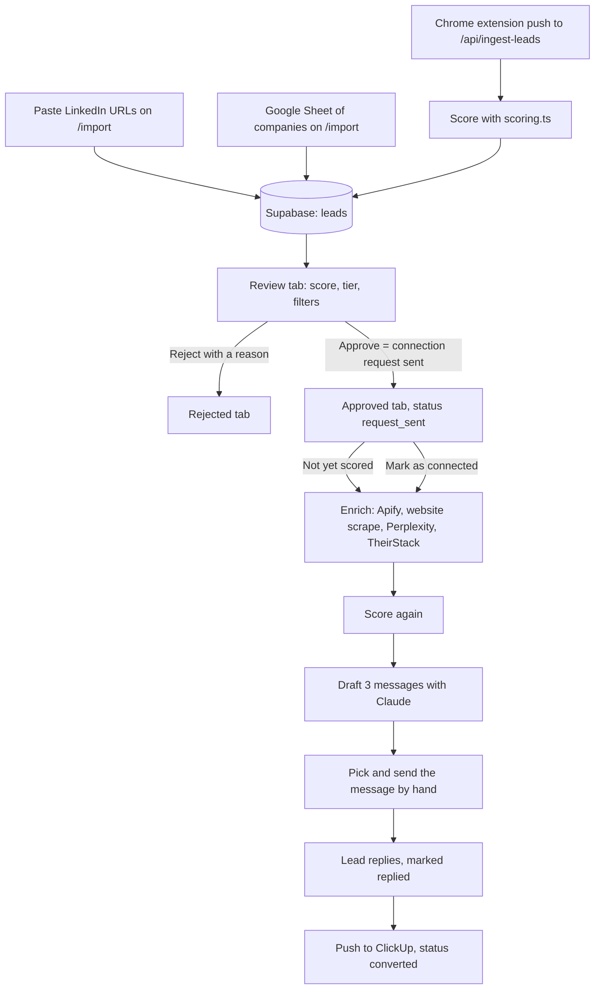

# digx-leadgen-web

A web app for working a B2B outbound lead pipeline. It collects LinkedIn leads, scores each one against an ideal customer profile (ICP), enriches the leads you approve, drafts three outreach messages per lead with Claude, and creates a ClickUp task when a lead is ready for sales.

The app never sends messages. A person sends them on LinkedIn and marks the lead as connected, replied or converted in the app.

This repository ships with fictional demo data only. Every person and company in `supabase/seed.sql` is made up.

## How it works



The browser extension that feeds `/api/ingest-leads` is not part of this repository. The other two entry points work without it.

## Features

- **Pipeline table** (`/`): tabs for Review, Approved, Rejected, Active and All. Filters for status, tier, category, industry and source, search, sorting, paging, bulk delete and bulk category edit.
- **Lead drawer**: profile, enrichment, score breakdown, message variants, notes, and the actions for each stage.
- **Qualification**: approve or reject a lead, with a rejection reason. Each change is written to an audit log by a database trigger.
- **Import** (`/import`): paste one LinkedIn URL, paste a list, or paste a Google Sheet export of companies.
- **ICP scoring**: deterministic score from 0 to 100 with tiers HOT, WARM, COLD and SKIP. See Scoring below. Tier thresholds and extra exclusion keywords are editable on the Settings page.
- **Enrichment**: profile scrape through Apify, company website scrape, research through Perplexity, tech stack and hiring signals through TheirStack.
- **Message drafts**: three variants per lead from the Claude API, stored on the lead.
- **ClickUp push**: creates one task per lead, once.
- **Analytics** (`/analytics`): funnel, acceptance rate, reply rate, approvals against rejections per user, rejection reasons, tier mix.
- **Settings** (`/settings`): API keys, ClickUp connection, ICP rules.
- **Auth**: Supabase Auth with email and password. There is no sign-up page.

## Tech stack

Next.js 16 (App Router), React 19, TypeScript, Tailwind CSS 4, shadcn/ui with base-ui, Recharts, Sonner, Supabase (Postgres, Auth, row level security). External APIs: Anthropic, Perplexity, Apify, TheirStack, ClickUp.

## Quick start with the demo data

You need Node.js 20.9 or newer (the Next.js 16 minimum) and a free Supabase project.

1. Install dependencies:
   ```bash
   npm install
   ```
2. In the Supabase SQL editor, run the files in `supabase/migrations/` in numeric order (`001` to `013`; there is no `009`).
3. Run `supabase/seed.sql` the same way. It adds 15 fictional leads in the Review tab.
4. Create `.env.local` from the example and fill in the three Supabase values:
   ```bash
   cp env.example .env.local
   ```
5. In Supabase, go to Authentication, Users, and add a user with an email and a password. Accounts are created by hand.
6. Score the demo leads. The seed leaves `icp_score` empty on purpose:
   ```bash
   npm install --no-save dotenv tsx
   npx tsx scripts/rescore-all.ts
   ```
7. Start the app and sign in with the user from step 5:
   ```bash
   npm run dev
   ```
   Open http://localhost:3000.

Other scripts: `npm run build`, `npm run start`, `npm run lint`. The files in `scripts/` are manual helpers, not an automated test suite.

Pipeline, scoring, review and analytics work with no third-party keys. Approving a lead that has no score yet starts enrichment, which needs the Apify, Perplexity and TheirStack keys. Message drafts need the Anthropic key. The ClickUp push needs a ClickUp token and list id.

## Environment variables

Set these in `.env.local`. The API keys marked "Settings" can also be saved on the `/settings` page, which stores them in the `app_config` table. An environment variable wins over the saved value.

| Variable | Needed | What it does |
|---|---|---|
| `NEXT_PUBLIC_SUPABASE_URL` | Required | Supabase project URL. Used by the browser, server and middleware clients. |
| `NEXT_PUBLIC_SUPABASE_ANON_KEY` | Required | Supabase anon key. Also the shared secret the extension routes (`/api/ingest-leads`, `/api/health`) check. |
| `SUPABASE_SERVICE_ROLE_KEY` | Required | Server only. Admin client for `app_config`, extension ingest, settings, ClickUp and `scripts/rescore-all.ts`. Never expose it to the browser. |
| `ANTHROPIC_API_KEY` | Optional, Settings | Message drafts (`/api/generate`). |
| `PERPLEXITY_API_KEY` | Optional, Settings | Company research, website lookup and profile resolution during enrichment. |
| `THEIRSTACK_API_KEY` | Optional, Settings | Tech stack and hiring signals during enrichment. |
| `APIFY_TOKEN` | Optional, env only | LinkedIn profile scrape for leads that have no profile data yet. The Settings page cannot save it. |
| `APIFY_LINKEDIN_ACTOR` | Optional | Apify actor to use. Default: `apimaestro~linkedin-profile-detail`. |
| `NEXT_PUBLIC_EXTENSION_ID` | Optional | Chrome extension id read by `src/lib/extension.ts`. That module is not used by any page at the moment. |
| `NEXT_PUBLIC_SUPABASE_DASHBOARD_URL` | Optional | Link target for "Supabase dashboard" on Settings. Default: https://supabase.com/dashboard |
| `NEXT_PUBLIC_VERCEL_DASHBOARD_URL` | Optional | Link target for "Vercel deployments" on Settings. Default: https://vercel.com/dashboard |

ClickUp has no environment variables. Save `clickup_api_token`, `clickup_list_id` and optionally `clickup_team_id` on the Settings page.

## Project structure

| Path | What is in it |
|---|---|
| `src/app/` | Pages: pipeline (`page.tsx`), `import/`, `analytics/`, `settings/`, `login/` |
| `src/app/api/` | Route handlers (see `docs/ARCHITECTURE.md`) |
| `src/components/` | Lead drawer, sidebar, inline cells, category picker, ICP editor, settings tabs, and `ui/` (shadcn components) |
| `src/lib/` | `scoring.ts`, `icp-rules.ts`, `enrichment.ts`, `clickup.ts`, `config.ts`, `sla.ts`, Supabase clients, auth guard |
| `src/types/` | Lead type |
| `src/middleware.ts` | Refreshes the Supabase session and redirects signed-out visitors to `/login` |
| `supabase/migrations/` | Database schema, numbered `001` to `013` |
| `supabase/seed.sql` | 15 fictional demo leads |
| `scripts/` | `rescore-all.ts` (re-score every lead), `test-enrich-one.ts`, `test-reject.mjs` (manual browser test) |
| `docs/ARCHITECTURE.md` | Data model, API routes, external services |

## Scoring

`src/lib/scoring.ts` is plain deterministic code. It makes no network calls and costs nothing to run. A lead's score is the sum of five parts, limited to 0 to 100:

| Part | Range | How |
|---|---|---|
| Role | 0 to 25 | Keywords in the headline and the two most recent job titles. Founder, owner or CEO scores 25. COO and similar score 20. Director and senior commercial titles score 15 or 10. Manager, consultant or lead scores 5. |
| Segment | 0 to 25, plus up to 5 | Best match across seven profiles from industry, description, specialties and headline: consulting 25, agency 25, legal and accounting 20, wholesale 25, food and beverage 25, direct-to-consumer 23, consumer goods 22. Each signal word such as "organic" or "export" adds 2, capped at 5. |
| Company size | 0 to 20 | 11 to 50 people scores 20, 51 to 200 scores 17, 2 to 10 scores 12, 201 to 500 scores 8, 501 to 2000 scores 3. Unknown size scores 10. |
| Location | 0 to 15 | 15 for the primary countries listed in the code, 10 for the secondary list, 5 for anywhere else, 2 if unknown. |
| Category alignment | -5, 0 or 10 | +10 when the category you set (service or product) matches the detected segment track, -5 when it contradicts it. |

Some leads are forced to score 0 and tier SKIP before any of this: direct competitors, restaurant and hotel operators, retail buyers, alcohol, construction, heavy industry, software vendors, transport and logistics, companies with more than 5000 employees, and any exclusion keywords you add on the Settings page.

Tiers default to HOT at 70 or more, WARM at 50, COLD at 30, otherwise SKIP. You can change the three thresholds on the Settings page.

The keyword lists, weights and country lists were written for one specific ICP. Change `scoring.ts` to fit yours.

## Status and limits

- Demo data only. No real leads are included.
- No automated test suite. `scripts/test-reject.mjs` is a manual browser script with placeholder credentials.
- Message drafting uses a fixed prompt in `src/app/api/generate/route.ts`, written for a specific sender and offer, and a Claude model id that is hard-coded there. Edit both before real use.
- The Chrome extension that pushes leads to `/api/ingest-leads` is not included. `src/lib/extension.ts` and `/api/find-linkedin` are in the code but no page calls them.
- The Google Sheet import reads a fixed set of column names: Company (required), Brands, Event, Stand, ICP Score, Own Distribution, Young Leadership, Description, ICP Fit Reasons. It creates company-only leads, sets their industry to Food & Beverage, and stores the ICP Score from the sheet as is instead of running `scoring.ts`.
- The app does not send messages. Sending is manual.
- Migrations are plain SQL files that you run yourself. There is no migration runner.

## License

MIT. See [LICENSE](LICENSE).
